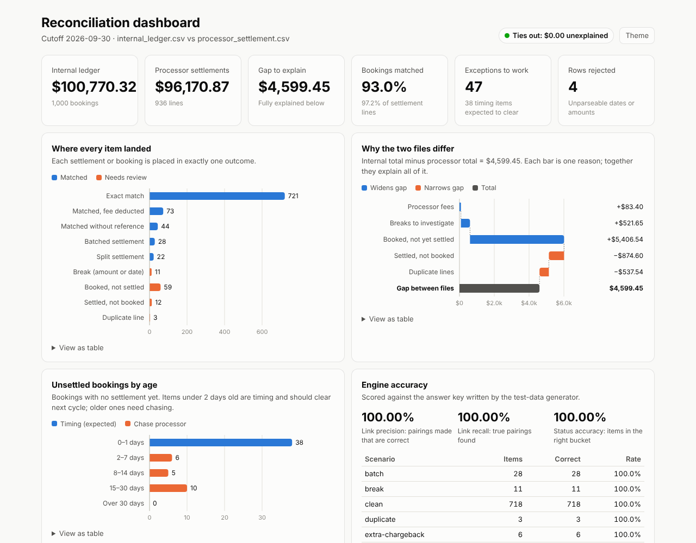

# Bank ↔ Payment Processor Reconciliation Engine

A Python engine that reconciles a bank's internal transaction ledger against a
payment processor's settlement file. It matches records that don't line up
perfectly, explains every dollar of difference, and produces the exceptions
report an operations team works from each morning.

**[▶ View the live dashboard](https://sangavisambathkumar.github.io/bank-reconciliation-engine/)** — no install needed.

[](https://sangavisambathkumar.github.io/bank-reconciliation-engine/)

```
Internal ledger (1,000 rows)  ─┐                         ┌─► Excel report (7 sheets)
                               ├─► normalize ─► 8 match ─┼─► HTML dashboard + CSV detail
Processor file  (  939 rows)  ─┘    + validate   passes  └─► Proof: gap explained to $0.00
```

## The business problem

When a customer pays a merchant by card, the bank books the payment straight
away. The processor (e.g. Moneris, Stripe, Square) settles the money a day or
two later, in its own file format. The two files should agree, but they rarely
match line for line:

| What goes wrong | Example | Engine result |
|---|---|---|
| Different formats | `TXN-000123` vs `txn000123`; `2026-09-14` vs `14/09/2026`; `Joe's Cafe` vs `SQ *JOES CAFE TORONTO ON` | Normalized, then matched |
| Processor fees | Booked $100.00, settled $98.55 | `MATCHED_TOLERANCE` (fee reported) |
| Missing reference | Processor line has no reference | `MATCHED_FUZZY` on amount + date + merchant |
| Batching | 3 payments settled as one $212.40 deposit | `MATCHED_MANY_TO_ONE` |
| Splitting | One payment settled in two parts | `MATCHED_ONE_TO_MANY` |
| Wrong amount | Booked $120.00, settled $84.00 (partial refund) | `BREAK`: investigate |
| Not settled yet | Booked on the 30th, cutoff the 30th | `UNMATCHED_INTERNAL` tagged **TIMING** |
| Never settled | Booked on the 3rd, still missing | `UNMATCHED_INTERNAL`, chase processor |
| Processor-only | Chargebacks, unidentified deposits | `UNMATCHED_PROCESSOR` |
| Sent twice | Same settlement line repeated | `DUPLICATE` |
| Corrupt rows | `31/09/2026`, `12..50` | Rejected with the reason |

Reconciliation teams spend hours on this by hand in Excel. Automating the easy
95% lets people focus on the exceptions that actually carry risk.

## How the matching works

Passes run from **most certain to least certain**. Each pass only sees what earlier
passes left open, so a weak rule can never steal a record that a strong rule
would have matched correctly.

| # | Pass | Rule |
|---|---|---|
| 0 | Duplicates | Same reference + amount + date appearing twice in one file |
| 1 | Exact | Same reference, same amount, settlement within the date window |
| 2 | Tolerance | Same reference, difference ≤ $2.50 (configurable): treated as a fee |
| 3 | Fuzzy | No usable reference: exact amount + date window + merchant-name similarity score ≥ 0.80 |
| 4a | One-to-many (ref) | One booking = sum of 2–4 settlement lines that share its reference |
| 4b | Many-to-one | One settlement line = sum of 2–4 same-day bookings for the same merchant |
| 4c | One-to-many (name) | Splits that lost their reference |
| 5 | Breaks | Same reference but amount or date disagree beyond tolerance |
| 6 | Leftovers | Unmatched, split into **timing** (near cutoff) vs **genuine** exceptions |

Key design decisions (good interview material):

- **Money is integer cents**, never floats. Summing 10,000 floats drifts; cents don't.
- **Reservation.** A record whose reference still has a partner on the other side
  is held back from the name-based passes. That way a split or break is never
  pulled apart by a coincidental fuzzy match.
- **Batch search prefers the exact sum over the smallest group.** A two-way
  combination that lands within tolerance loses to an exact three-way batch.
- **Batches are searched within one booking date**, mirroring how processors
  actually batch. This keeps the combinatorial search small and stops payments
  from different days being glued together.
- **Ambiguity is flagged, not hidden.** If two candidates score equally, the
  fuzzy match is labeled `AMBIGUOUS` for review.
- **Every record ends up in exactly one group.** That is what makes the proof possible.

### The reconciliation proof

The Summary sheet shows the check every auditor asks for:

```
Internal ledger total                           100,770.32
Less: processor settlement total                 96,170.87
Gap to explain                                    4,599.45
  Fees on tolerance matches                          83.40
  Breaks (amount disagreements)                     521.65
  Booked, not yet settled                         5,406.54
  Settled, not booked                              -874.60
  Duplicate lines                                  -537.54
Unexplained (must be 0.00)                            0.00   TIES OUT
```

If "Unexplained" is ever not zero, the engine has lost or double-counted a
record. The CLI exits with code 2, so a scheduled job would fail loudly.

## Results

The generator writes an answer key (`ground_truth.json`), so accuracy is
measured rather than assumed.

| Dataset | Rows | Link precision | Link recall | Status accuracy | Runtime |
|---|---|---|---|---|---|
| Sample (seed 42) | 1,000 | 100.00% | 100.00% | 100.00% | 0.2 s |
| 5 seeds | 1,000 each | 100.00% | 100.00% | 100.00% | ~0.1 s |
| 5 seeds | 10,000 each | 99.97–100% | 99.97–100% | 99.98–100% | ~3 s |

- **Precision** is the share of pairings the engine made that are correct. A wrong
  pairing is worse than none, because it hides a real exception.
- **Recall** is the share of true pairings the engine found.

The only misses at 10k volume are genuine coincidences: a payment with no
reference that has the *exact* same amount, merchant and day as a member of a
batch. No rule can separate those without more data, such as card number or
authorization code.

## Project structure

```
recon-engine/
├── config.json              column mappings, date formats, tolerances
├── recon/
│   ├── normalize.py         amounts → cents, reference/name cleaning, similarity
│   ├── loader.py            CSV → Records, rejects bad rows with reasons
│   ├── models.py            Record, MatchGroup, Status
│   ├── config.py            typed settings
│   ├── matcher.py           the multi-pass engine + reconciliation proof
│   ├── report.py            Excel workbook + CSV + console summary
│   ├── dashboard.py         self-contained interactive HTML dashboard
│   ├── generate.py          realistic messy test data + answer key
│   ├── evaluate.py          precision / recall / status accuracy
│   └── cli.py               command-line interface
├── tests/                   46 tests: normalizers, each pass, dashboard, end to end
├── data/                    sample input (generated)
├── output/                  sample report + dashboard (generated)
└── docs/                    the published dashboard (GitHub Pages)
```

## Quick start

Requires Python 3.10+.

```bash
pip install -r requirements.txt

python -m recon generate     # create data/internal_ledger.csv, data/processor_settlement.csv, data/ground_truth.json
python -m recon run          # reconcile → output/recon_report.xlsx, recon_results.csv, dashboard.html
python -m recon evaluate     # run + score against the answer key
python -m recon dashboard    # write only the HTML dashboard (see below)
python -m pytest             # run the test suite
```

Use your own files:

```bash
python -m recon run --internal my_ledger.csv --processor my_settlement.csv --config my_config.json
```

Edit `config.json` to map your column names and date format. No code changes needed:

```json
"processor": {
  "columns": { "record_id": "SettlementID", "txn_date": "SettleDate", "amount": "NetAmount",
               "currency": "Ccy", "reference": "Ref", "counterparty": "MerchantName" },
  "date_format": "%d/%m/%Y"
}
```

| Setting | Default | Meaning |
|---|---|---|
| `date_window_days` | 3 | Settlement may land up to N days after booking |
| `amount_tolerance_cents` | 250 | Differences up to $2.50 count as fees, not breaks |
| `amount_tolerance_pct` | 0.0 | Optional %-based tolerance (the larger of the two applies) |
| `fuzzy_threshold` | 0.80 | Minimum score for a fuzzy match |
| `fuzzy_amount_tolerance_cents` | 0 | Fuzzy matches need an exact amount by default |
| `name_match_threshold` | 0.80 | Name similarity needed to group batches and splits |
| `max_group_size` | 4 | Largest batch or split to assemble |
| `settlement_lag_days` | 2 | Unmatched items this close to cutoff are tagged TIMING |

## The report

| Sheet | Who uses it | Contents |
|---|---|---|
| Summary | Manager / auditor | Match rates, totals by status, the proof |
| Matched | Audit trail | Every matched group, one row per record, with rule and score |
| Breaks | Analyst (first priority) | Same reference, wrong amount or date, with the reason |
| Unmatched_Internal | Analyst | Timing items vs. items to chase, with age in days |
| Unmatched_Processor | Analyst | Chargebacks and unidentified deposits |
| Duplicates | Analyst | Possible double postings |
| Rejected | Data owner | Rows that couldn't be parsed, with the raw data |

## The dashboard

`python -m recon dashboard` turns any reconciliation run into one HTML file:
data is embedded and charts are drawn with plain JavaScript, so it has no
dependencies and works opened from a folder, attached to an email, or hosted.
[See it live.](https://sangavisambathkumar.github.io/bank-reconciliation-engine/)

| Panel | What it answers |
|---|---|
| Headline cards + "Ties out" badge | How big are the two files, how much is matched, does it balance? |
| Where every item landed | How many items fell into each outcome |
| Why the two files differ | A bridge chart walking from $0 to the full gap, one reason at a time |
| Unsettled bookings by age | Which unsettled items are just timing and which need chasing |
| Engine accuracy | Precision, recall and per-scenario results vs. the answer key (optional) |
| Exceptions to work | Filter by queue (breaks, not settled, not booked, duplicates, timing), search, sort |

It supports light and dark themes, works on phones, has hover tooltips on
every bar, and a "View as table" option under each chart for accessibility.

```bash
python -m recon dashboard --out docs/index.html --truth data/ground_truth.json   # rebuild the published page
python -m recon dashboard --internal my_ledger.csv --processor my_settlement.csv --out my_dashboard.html
```

To publish your own copy, enable GitHub Pages in the repo settings
(**Settings → Pages → Deploy from a branch → `main` / `docs`**).

## Ideas to extend it

- **Learned matching:** train a classifier on analysts' accept/reject decisions to replace the hand-tuned fuzzy weights.
- **Card-level keys:** add auth code / masked PAN / terminal ID to resolve the remaining coincidences.
- **Multi-currency:** FX conversion at the settlement-date rate, with FX differences reported separately.
- **Carry-forward:** feed yesterday's open timing items into today's run and age them automatically.
- **Database + API:** store results in PostgreSQL, expose a FastAPI endpoint, and add a review UI where analysts confirm matches.
- **Scale:** replace the in-memory passes with SQL joins or Polars for millions of rows.
- **ISO 20022:** parse `camt.053` bank statements as an input format.

## Résumé bullets

- Built a multi-pass reconciliation engine in Python that matches bank ledger records to processor settlement files across fees, batched and split settlements, missing references and duplicates, at 99.97–100% precision and recall on 10,000-transaction test sets.
- Designed a self-checking reconciliation proof that explains every dollar of difference between the two files and fails the run if anything is unaccounted for.
- Produced a 7-sheet Excel exceptions report and an interactive, dependency-free HTML dashboard (published on GitHub Pages) separating timing differences from genuine breaks, so analysts can prioritize risk.
